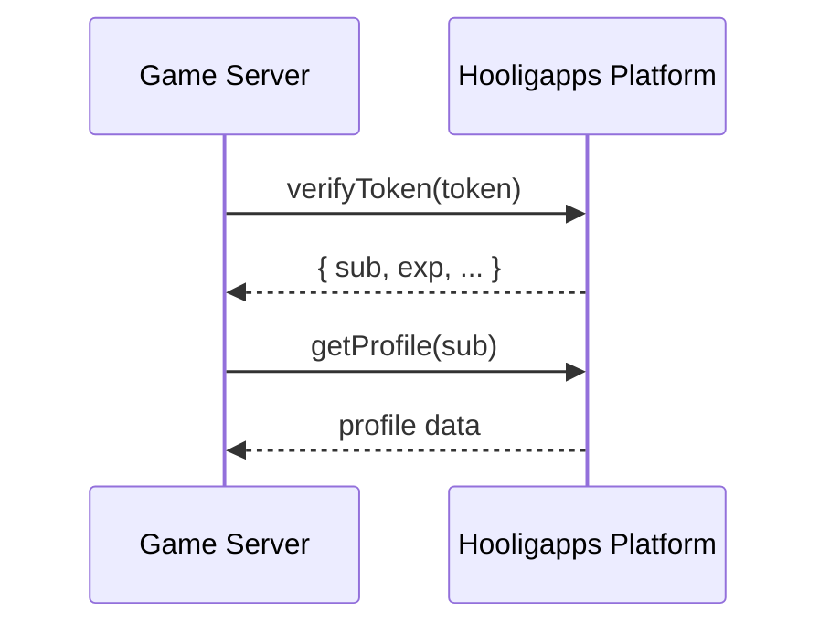
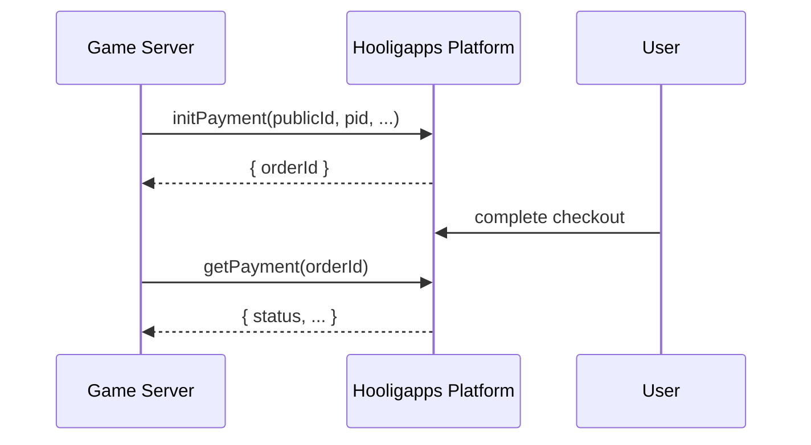

# happs-nodejs

Node.js client for the Hooligapps Bridge API.

## Installation

From the Git repository:

```bash
npm i git+https://github.com/hooligapps/happs-nodejs.git#v1.1.1
```

Local install from the project folder:

```bash
npm i .
```

## Requirements

- Node.js 20+
- `platformUrl` must be an absolute HTTP(S) origin without credentials, path, query, or hash.

## Usage

```js
const {
  HAppsClient,
  HAppsHttpError,
  HAppsTimeoutError,
  HAppsNetworkError,
} = require("happs-nodejs");
```

If you use it locally from the library folder:

```js
const { HAppsClient } = require("./index");
```

## Methods

- `verifyToken(token)`
- `getProfile(publicId)`
- `initPayment(publicId, pid, name, price, currency, desc)`
- `initPaymentByUserId(params)`
- `getPayment(orderId)`
- `createSessionLink(publicId)`
- `bindUserId(params)`
- `migrateAccount(params)`
- `submitGameSession(params)`

`HAppsOidcClient` methods:

- `createAuthorizationRequest(options)`
- `exchangeAuthorizationCode(callbackUrl, expected)`
- `getUserInfo(tokens, options)`

## OIDC Authorization Code Flow

The SDK creates the portal authorization URL and performs the callback exchange. The game server remains responsible for storing the returned state, nonce and PKCE verifier in its own session or Redis storage.

```js
const { HAppsOidcClient } = require("happs-nodejs/oidc");

const oidc = new HAppsOidcClient({
  issuerUrl: "https://hooli.games/idp/oidc",
  clientId: "CLIENT_ID",
  clientSecret: "OIDC_CLIENT_SECRET",
  redirectUri: "https://game.example.com/api/auth/idp/callback",
  scope: "openid email",
});

const authorization = await oidc.createAuthorizationRequest();

await saveAuthorizationState({
  state: authorization.state,
  nonce: authorization.nonce,
  codeVerifier: authorization.codeVerifier,
});

// Redirect the browser to authorization.url.

const tokens = await oidc.exchangeAuthorizationCode(callbackUrl, {
  state: authorization.state,
  nonce: authorization.nonce,
  codeVerifier: authorization.codeVerifier,
});

const userInfo = await oidc.getUserInfo(tokens);
```

`HAppsClient` and `HAppsOidcClient` are configured separately because the Bridge API secret and OIDC client secret may differ. Both `jose` and `openid-client` are installed automatically with this package. The OIDC issuer and redirect URI are fixed for the lifetime of the client so the authorization and callback steps cannot accidentally use different values. Pass `prompt: "login"` explicitly only when the portal must reauthenticate the user. UI concerns such as opening a popup and receiving `postMessage` events intentionally remain outside this Node.js package.

## Portal Session Link

Create a short-lived, single-use link that signs the linked player into the portal when opened:

```js
const { url, expiresIn } = await client.createSessionLink(
  "8a46b842-3034-4c96-b2e2-8c3cb04b72bb",
);
```

Call this method only on the game server. The Bridge request is authenticated with the game's HMAC secret. After creating the portal session, the link redirects to the portal home page.

## Complete Portal Authentication

After the browser reaches the game, read the game's own session cookie and complete the portal authentication attempt:

```js
const result = await client.submitGameSession({
  authId: request.query.authId,
  ...(currentPlayer ? { userId: String(currentPlayer.id) } : {}),
});

response.redirect(result.redirectUrl);
```

Omit `userId` when the game session does not exist. Never copy the expected user ID from an email URL into this field. Hooligapps compares the expected user stored for `authId` with the current game user. The game should redirect the browser only to the returned `redirectUrl`.

## Account Migration

Migrate a verified game account and create or reuse its portal game link:

```js
const { publicId } = await client.migrateAccount({
  userId: "123456",
  email: "player@example.com",
  credential: {
    algorithm: "bcrypt",
    hash: "$2b$10$...",
  },
});
```

`migrateAccount(params)` accepts `AccountMigrationParams` and returns `Promise<AccountMigrationResult>`. Both TypeScript interfaces are exported by `happs-nodejs`. The `credential.algorithm` field may be omitted and defaults to `bcrypt`, which is the only algorithm currently accepted.

Call this method only on the game server and only for accounts whose email was verified by the game. Account migration must be explicitly enabled for the game by the platform. The bcrypt hash is transferred unchanged; the SDK does not convert or log it. If the email already belongs to an active verified portal account, its existing portal credential is preserved and only the game is linked.

## Interaction Flows

### Auth Flow



### Payment Flow



For a game player who does not have a Hooligapps `publicId` yet, initialize the payment by the game's stable user ID:

```js
const payment = await client.initPaymentByUserId({
  userId: "123456",
  pid: "purchase-789",
  name: "1000 Gold",
  price: 9.99,
  currency: "USD",
  desc: "1000 Gold",
});

// Send only payment.paymentUrl to the game client and open it in the browser.
// Store payment.publicId for future Bridge calls when possible.
console.log(payment.publicId, payment.orderId, payment.paymentUrl);
```

`userId` is the stable player ID owned by the game. Hooligapps finds or creates an unregistered game link for `(game, userId)`. A later `migrateAccount(...)` call for the same `userId` claims that link without changing its `publicId` or payment history.

After resolving or creating a local player from a portal/OIDC launch, bind the game's stable user ID once:

```js
await client.bindUserId({
  publicId: tokenData.sub,
  userId: String(localPlayer.id),
});
```

The operation is idempotent for the same pair. It returns `409 Conflict` instead of replacing either side when the `publicId` or `userId` is already bound differently.

## Example

```js
const client = new HAppsClient("https://hooli.games", "CLIENT_ID", "SECRET");

async function run(token) {
  try {
    const tokenData = await client.verifyToken(token);
    const profile = await client.getProfile(tokenData.sub);
    const payment = await client.initPayment(
      tokenData.sub,
      "76df333e-b84a-46c2-a4f0-4b6c078c70f6",
      "150 crystals",
      9.99,
      "USD",
      "Starter pack",
    );
    console.log(profile.publicId, payment.orderId);
  } catch (e) {
    if (e instanceof HAppsHttpError) {
      console.error("HTTP", e.status, e.errorCode, e.bodyText);
      return;
    }
    if (e instanceof HAppsTimeoutError) {
      console.error("Timeout");
      return;
    }
    if (e instanceof HAppsNetworkError) {
      console.error("Network error");
      return;
    }
    console.error(e);
  }
}
```


## Server-side Portal Request Helpers

Use these helpers on the game server for Portal -> game server requests such as mobile payment validation and payment postback.

```js
const { HAppsClient } = require("happs-nodejs");

function verifyPortal(req, gameApiSecret, expectedClientId) {
  return HAppsClient.verifyHAppsRequest({
    secret: gameApiSecret,
    method: req.method,
    path: req.path,
    timestamp: req.headers["x-timestamp"],
    signature: req.headers["x-signature"],
    body: req.body,
    clientId: req.headers["x-game-id"],
    expectedClientId,
  });
}

app.post("/api/v1/mobile/payment/validate", express.json(), (req, res) => {
  verifyPortal(req, process.env.HAPPS_API_SECRET, process.env.HAPPS_CLIENT_ID);
  const payment = HAppsClient.parsePaymentValidationRequest(req.body);

  res.json({
    ok: true,
    product: {
      productId: payment.productId,
      price: 2.99,
      currency: "USD",
      desc: "Starter pack",
      name: "Starter pack",
    },
  });
});

app.post("/api/v1/mobile/payment/postback", express.json(), async (req, res) => {
  verifyPortal(req, process.env.HAPPS_API_SECRET, process.env.HAPPS_CLIENT_ID);
  const postback = HAppsClient.parsePaymentPostback(req.body);

  if (postback.status === "approved") {
    await grantRewardOnce(postback.requestId, postback.orderId, postback.publicId);
  }

  res.json({ ok: true });
});
```

The signature format matches the bridge HMAC format:

```text
METHOD + "\n" + path + "\n" + timestamp + "\n" + sha256(JSON.stringify(body))
```

Expected headers:

- `x-game-id`
- `x-timestamp`
- `x-signature`

## JWKS Token Verification Example

Use this when you want local JWT verification via platform JWKS (no API call for token verification):

```js
const { HAppsClient } = require("happs-nodejs");

const client = new HAppsClient("https://hooli.games", "CLIENT_ID", "SECRET");

async function verifyWithJwks(token) {
  const payload = await client.verifyTokenJWKS(token);

  return {
    sub: payload.sub,
    userId: payload.userId,
    verified: payload.verified,
    aud: payload.aud,
  };
}
```

`userId` is optional. It is present only when the game link is already bound to a game user via `bindUserId()` or account migration. For a new portal launch, create the game user using `sub` as the portal link ID, then call `bindUserId()`.

`verifyTokenJWKS()` verifies the JWT signature, issuer, audience, expiration and required launch-token claims locally. It does not consume or persist `jti`, so it cannot prevent replay by itself. Use the Bridge `verifyToken()` method when the token must be accepted only once.

## Client Features

- HMAC request signing compatible with bridge guard format
- `X-Request-Id` for every request
- retries for timeout/network/HTTP 5xx
- retries are limited to GET requests; POST requests are never retried automatically
- one `X-Request-Id` is preserved across all attempts of a logical request
- input validation (`price > 0`, required strings must be non-empty)
- typed errors for easier integration handling

## Versions

Changelog: `CHANGELOG.md`.
