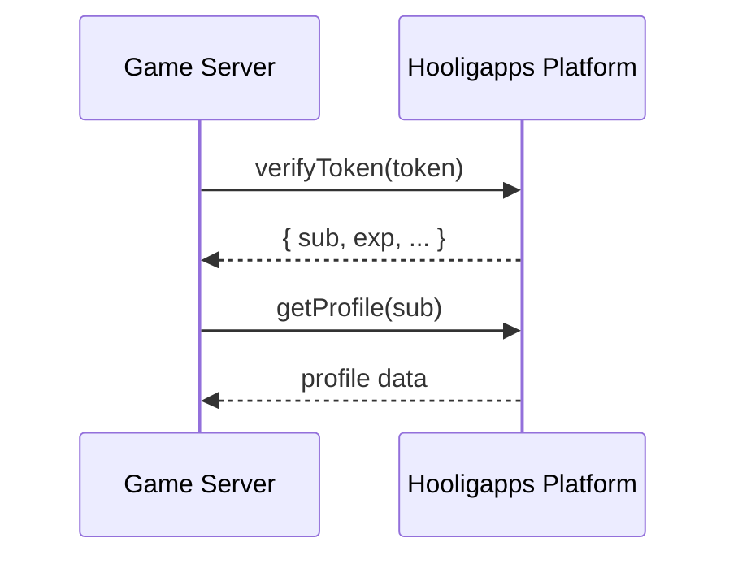
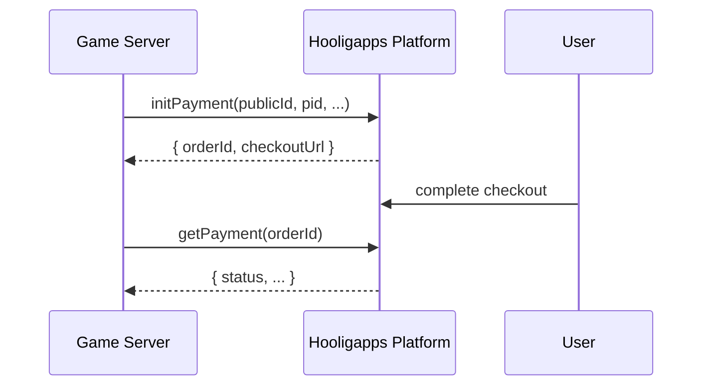

# happs-nodejs

Node.js client for the Hooligapps Bridge API.

## Installation

From the Git repository:

```bash
npm i git+https://github.com/hooligapps/happs-nodejs.git#v1.0.2
```

Local install from the project folder:

```bash
npm i .
```

## Requirements

- Node.js 18+

## Usage

```js
const {
  HAppsClient,
  HAppsHttpError,
  HAppsTimeoutError,
  HAppsNetworkError,
} = require("happs-nodejs");
```

If you use it locally from the library folder:

```js
const { HAppsClient } = require("./client");
```

## Methods

- `verifyToken(token)`
- `getProfile(publicId)`
- `initPayment(publicId, pid, name, price, currency, desc)`
- `createCheckout(publicId, pid, name, price, currency, desc, options?)`
- `getPayment(orderId)`

## Interaction Flows

### Auth Flow



### Payment Flow



## Example

```js
const client = new HAppsClient("https://hooli.games", "CLIENT_ID", "SECRET");

async function run(token) {
  try {
    const tokenData = await client.verifyToken(token);
    const profile = await client.getProfile(tokenData.sub);
    const payment = await client.initPayment(
      tokenData.sub,
      "76df333e-b84a-46c2-a4f0-4b6c078c70f6",
      "150 crystals",
      9.99,
      "USD",
      "Starter pack",
    );
    const checkout = await client.createCheckout(
      tokenData.sub,
      "76df333e-b84a-46c2-a4f0-4b6c078c70f6",
      "150 crystals",
      9.99,
      "USD",
      "Starter pack",
      { redirectUrl: "mygame://payment-finish" },
    );

    console.log(profile.publicId, payment.orderId, checkout.paymentUrl);
  } catch (e) {
    if (e instanceof HAppsHttpError) {
      console.error("HTTP", e.status, e.errorCode, e.bodyText);
      return;
    }
    if (e instanceof HAppsTimeoutError) {
      console.error("Timeout");
      return;
    }
    if (e instanceof HAppsNetworkError) {
      console.error("Network error");
      return;
    }
    console.error(e);
  }
}
```

## JWKS Token Verification Example

Use this when you want local JWT verification via platform JWKS (no API call for token verification):

```js
const { HAppsClient } = require("happs-nodejs");

const client = new HAppsClient("https://hooli.games", "CLIENT_ID", "SECRET");

async function verifyWithJwks(token) {
  const payload = await client.verifyTokenJWKS(token);

  return {
    sub: payload.sub,
    verified: payload.verified,
    aud: payload.aud,
  };
}
```

## Client Features

- HMAC request signing compatible with bridge guard format
- `X-Request-Id` for every request
- retries for timeout/network/HTTP 5xx
- input validation (`price > 0`, required strings must be non-empty)
- typed errors for easier integration handling

## Versions

Changelog: `CHANGELOG.md`.
